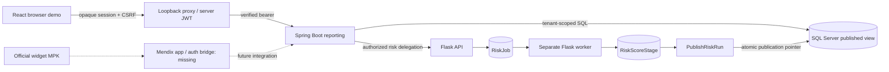
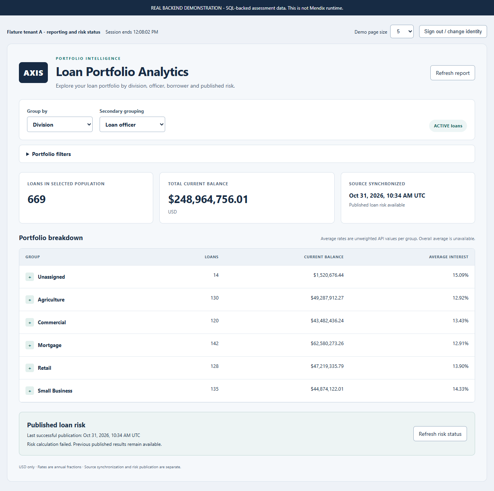

# AXIS Loan Portfolio Analytics

**Developer:** Alejandro Marchini

Interactive loan portfolio reporting: change grouping, inspect SQL-backed totals, drill into officers and paginated loans,
and view the last successfully published risk ratings. The browser demonstration reuses the actual Mendix widget's React
components. It is **not a Mendix application**.

The analytics backend, widget package and browser demonstration are available for review. The required operational
Mendix application, embedded runtime demonstration and application export remain outstanding. See the [page-referenced requirements matrix](docs/assessment-requirements.md).
The official widget MPK was built/validated; Studio Pro import and Mendix runtime execution were **NOT RUN**.

## Implementation status

| Component | Status / responsibility |
| --- | --- |
| SQL Server analytics | Implemented: tenant-qualified schema, SQL aggregation, deterministic fixtures, atomic publication |
| Flask API and worker | Implemented: Decimal prototype policy, jobs, leases, batches, stage/publish and recovery |
| Spring Boot reporting | Implemented: JWT/permissions, JDBC aggregates, two levels, signed keyset cursors, risk delegation |
| Mendix React widget | Source, XML, typings and editor assets preserved; official MPK built and validated |
| Real browser demo | Implemented: same dashboard, restricted loopback proxy and server-side JWTs |
| Mendix application | Not implemented; management pages, trusted auth bridge, synchronization and app export absent |

## Architecture



[Detailed architecture](docs/architecture.md), [decisions](docs/decisions.md) and [canonical contract](docs/data-contract.md)
explain the implemented boundaries and assumptions. SQL calculates COUNT/SUM/AVG; Java/Python use exact decimal math.
No Redis, RabbitMQ, Kafka, Kubernetes or second risk job system was introduced.

## Stack and features

| Area | Verified version / choice |
| --- | --- |
| Data | SQL Server 2022 CU23; DECIMAL(18,2) money and DECIMAL(7,4) annual fractional rates |
| Risk | Python 3.11; Flask 3.1.2; separate worker and cron-compatible scheduler command |
| API | Java 17.0.17; Spring Boot 3.5.16; JDBC; Maven Wrapper 3.9.11 |
| Widget | React 19.3.1, TypeScript 5.9.3, Mendix SDK 11.16.0 / tools 11.15.0 |
| Frontend tools | Node 22.23.4, npm 11.20.0, Playwright 1.64.1 with installed Chrome |

Four dimensions: division, loan officer, borrower type and published loan risk. Two-level grouping, lazy expansion,
null groups, SQL-backed filters and signed cursor pages avoid fetching every loan into the browser. API money/rates
remain decimal strings; USD-only and unweighted non-null average rates are labelled prototype assumptions. Source version,
publication UUID and timestamps are distinct. A failed/incomplete risk run cannot replace the prior publication.

## Quick start

**New checkout:** follow [complete setup](docs/setup.md) for prerequisites, safe environment generation, SQL initialization,
fictional seed, account provisioning, backend image builds and explicit first publication. A clone does not include the
current private .env, local tools, Docker images or published database. Full fresh-machine backend installation was not
rerun; isolated frontend install/build and offline fixture generation were executed.

**Existing published environment:** retain .env and the SQL volume; skip initialization, seeding and risk submission.
With the supported Node/npm/Python toolchain:

```powershell
docker compose --profile risk --profile backend config --quiet
docker compose --profile risk --profile backend up -d --no-build --wait
docker compose ps
Invoke-RestMethod http://127.0.0.1:8081/actuator/health/readiness
npm --prefix widget run preview:build
analytics-flask/.venv/Scripts/python.exe -B widget/scripts/demo.py --mode real --port 3099
```

Open **http://127.0.0.1:3099**. The launcher prints a private access-code file path; open it locally, choose the matching
fixture profile and paste its code. Never share codes or record the private file. Startup credentials expire within
15 minutes; stop with Ctrl+C and relaunch. Stop an earlier identified demo before reusing its port. JWTs/signing secrets
never enter the frontend. Default profiles cannot submit risk jobs and no jobs start automatically.

Current ports: SQL host 11433 (container 1433), Flask 8000, Spring 8081, demo 3099. All bind loopback. Default new SQL host
port is 1433; [setup](docs/setup.md) explains the consistent override. Use synthetic mode separately with
`npm --prefix widget run preview:serve`: it is clearly labelled MOCK DATA, has no backend proxy and never replaces a real-mode error.

## Five-minute demonstration

Sign in as tenant-a -> Division -> expand division -> expand officer -> Next/Previous loans -> Loan risk rating ->
apply a filter -> sign out -> tenant-b. Explain SQL totals, lazy loading and previous-publication retention. Finish by
showing the widget MPK and the explicit Mendix gap. See [reviewer walkthrough](docs/demo-walkthrough.md) and
[technical interview notes](docs/interview-walkthrough.md).

The existing fixture has **1,500 total / 1,334 active** loans, rather than the assignment's 1,500+ active-loan context.
Current observed active counts are A: 669, B: 665. Totals shown by the UI come from live API responses, not constants.
Historical 15,000-total-loan correctness/timing evidence is separate from this demo and from production load testing.

## Testing and evidence

```powershell
npm --prefix widget run check
analytics-flask/.venv/Scripts/python.exe -B widget/scripts/package-check.py
analytics-flask/.venv/Scripts/python.exe -B -m pytest widget/scripts/test_backend_launcher.py -q -p no:cacheprovider
analytics-flask/.venv/Scripts/python.exe -B widget/scripts/backend-tests.py
$env:DEMO_TEST_URL='http://127.0.0.1:3099' # protected real demo must already be running with fresh credentials
npm --prefix widget run test:browser
```

Fresh final-audit executions: **72 Jest cases**, **12 demo-server cases**, **6 smoke-launcher unit cases**,
**22 Node HTTP scenarios**, and **22 Playwright cases** (14 mocked / 7 real backend / 1 synthetic). These categories have
different evidence boundaries and are not presented as one complete application test. Formatting/lint/TypeScript and
official packaging passed. See [actual commands, failures and verification limits](docs/final-validation.md).

Historical [SQL/risk](docs/risk-service-validation.md), [reporting API](docs/reporting-api-validation.md),
[widget](docs/widget-validation.md) and [browser](docs/browser-demo-validation.md) evidence is retained. Expensive unchanged
SQL/Flask/Java suites were not rerun in the final audit and their old counts are not added to fresh results.

## Official widget package

[axis.loanportfolio.AxisLoanPortfolio.mpk](widget/releases/axis.loanportfolio.AxisLoanPortfolio.mpk), version 0.1.0.
Build/install compatibility, package ID, current size/checksum and archive checks: [widget README](widget/README.md) and
[package metadata](widget/package-results.json). A widget package is **not** the required exported Mendix application.

## Security and limitations

Verified JWT tenant/permissions scope every implemented service operation; reporting uses a read-only account and
risk:run remains separate from portfolio:read/risk:read. Tenant-qualified FKs prevent cross-tenant references. No RLS or
protection against compromised trusted service credentials is claimed. The demo has expiring opaque HttpOnly/SameSite
sessions, CSRF/Host/Origin checks, a fixed upstream/route allowlist and explicit risk-mutation opt-in (disabled normally).
It is local development authentication, not production OIDC or a trusted Mendix bridge; never expose it publicly.

Missing: operational Mendix loan management, embedded runtime, synchronization and app export. Nightly scheduling needs
an external installed scheduler; balance updates remain upstream. No production concurrency/SLA, exhaustive accessibility,
multi-browser certification or direct Mendix-origin CORS verification is claimed. Current npm audit: 9 low development-tree
advisories, zero production advisories. Root licensing/public-distribution decisions remain unresolved; the widget's existing
generated license is not a repository-wide ownership grant. Detailed audit findings and verification limits are documented
in [final validation](docs/final-validation.md).

## Repository guide

```text
sql/                 Schema, indexes, deterministic seed and SQL tests
analytics-flask/     API, pure risk policy, worker, scheduling, provisioning and tests
spring-boot/         JDBC reporting, JWT, signed cursors, delegation, wrapper and tests
widget/              Actual Mendix widget, browser host, scripts, tests and official releases
docs/                Contracts, architecture, setup, traceability, walkthroughs and evidence
mendix-app/          Placeholder only; no operational application
```

Component setup: [SQL](sql/README.md), [Flask](analytics-flask/README.md), [Spring](spring-boot/README.md),
[widget/demo](widget/README.md). [Submission checklist](docs/submission-checklist.md) separates acceptance blockers from
optional hardening. Confirm repository visibility, confidentiality and licensing with the assessment owner before publication.

## Reviewed screenshots

REAL BACKEND: fictional fixture, no credentials or borrower identifiers shown.



[Published risk groups](widget/evidence/browser-demo/real-published-risk.png) -
[Paginated nested loans, identifying cells masked](widget/evidence/browser-demo/real-nested-pagination.png) -
[Responsive layout](widget/evidence/browser-demo/real-responsive.png).
The [mocked error capture](widget/evidence/browser-demo/mocked-error.png) is explicitly mocked evidence, not a real outage.
