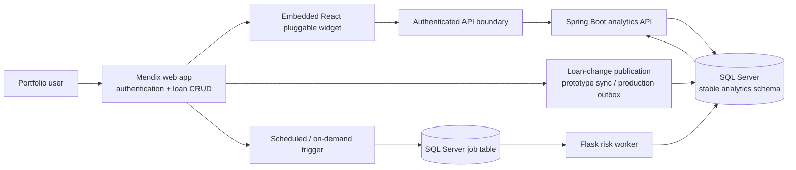

# AXIS Loan Portfolio Analytics — Architecture Decisions

**Assessment:** AIO Logic, Senior Full-Stack Developer — Loan Portfolio Analytics System  
**Status:** Proposed architecture; decisions fixed for the prototype, production hardening identified separately  
**Scope:** Part 1 (system design), with explicit implications for Part 2 (6–8-hour prototype)

## 1. Executive decision

Build the **required Mendix web application** as the operational user experience and loan-management system. Embed a
**real Mendix pluggable React/TypeScript widget** for portfolio analysis. Keep data grouping and financial totals in
**SQL Server**, exposed through a **small Spring Boot API**. Use **Flask** for a separately invoked risk-scoring engine
and a **SQL Server-backed job queue** for asynchronous work. Avoid Redis, RabbitMQ, and Kubernetes in the initial
prototype; document when they become necessary.

**Key principle:** _Move aggregates, not entire portfolios, across the network._ Fetch group counts and totals first;
fetch subgroups or paginated loan details only when expanded.

This design targets the assessment's current **1,500+ active loans** and anticipated **10× growth (~15,000+)**, without
pretending that 15,000 loans alone requires a distributed architecture.

### Requirements traceability

| Assessment requirement                      | Design response                                                                      |
| ------------------------------------------- | ------------------------------------------------------------------------------------ |
| Mendix application to manage/view loans     | Mendix `Loan` entity, basic create/edit/list pages and role-aware microflows         |
| React widget embedded in Mendix             | Mendix pluggable widget package with grouping controls and expandable rows           |
| Dynamic primary and secondary grouping      | Server-side allowlisted dimensions; level-by-level SQL queries                       |
| Count, total balance, average interest rate | SQL Server `COUNT`, `SUM`, `AVG`; documented numeric semantics                       |
| Drill-down to loans                         | Expand-on-demand group API and paginated loan endpoint                               |
| Nightly/on-demand risk updates              | Scheduled trigger + job queue + Flask worker + published run version                 |
| Heavy processing without blocking UI        | Background batches and last-computed results; job status indicator                   |
| Tenant isolation and application security   | Claims-derived tenant, Mendix entity access, API authorization, SQL defense-in-depth |
| Tests, error states, Docker Compose         | Unit/API/widget tests, visible error/loading states, containerized API/worker        |

## 2. Logical component design



**Data ownership:** Mendix owns operational loan editing and its application domain model. The **analytics schema** in
SQL Server is an explicitly versioned read model, not an undocumented dependency on Mendix-generated database tables. A
source-record change is carried into the analytics schema with stable `TenantId`, `LoanId`, and `SourceVersion` fields.
The risk worker writes calculated scores and run metadata, not operational loan facts.

**Authentication boundary:** The React widget runs inside the authenticated Mendix application. In the production
design, calls reach the API through an authenticated gateway or an OIDC-compatible token flow; Spring Boot validates the
caller and derives `TenantId` from a verified identity claim. The widget never chooses its own tenant or holds a
database credential. The exact Mendix-to-API authentication adapter is deployment-specific and must be configured and
tested, not assumed to be provided automatically by widget packaging.

**Important design constraint:** Mendix and Spring Boot must not independently update the same Mendix-managed records.
Direct querying of Mendix internal tables would couple a custom SQL API to Mendix-generated storage structures. The
reporting schema is a deliberate contract and is under our control.

## 3. Decision A — Where grouping and aggregation run

**Selected: SQL Server aggregations, called through Spring Boot.**

- **Not React:** shipping every loan to the browser increases payload size, memory, and cross-tenant exposure; browser
  aggregates can become inconsistent with server-side filters and updates.
- **Not Mendix microflow loops:** Mendix remains the operational application, but iterating over thousands of loan
  objects in application code adds memory and request overhead for work the database performs efficiently.
- **Not Java in-memory grouping:** Spring Boot validates and routes queries; it does not fetch 15,000 records just to
  calculate a sum.
- **SQL Server:** execute `GROUP BY` for the selected level, optionally `GROUPING SETS` for a fixed multi-level report
  when benchmarks show it is useful. Do **not** dynamically interpolate user-provided SQL identifiers.

### 3.1 Request flow

1. User selects **primary grouping** (`division`, `borrowerType`, `loanOfficer`, `riskRating`) and optional **secondary
   grouping**, such as `loanOfficer` within `division`.
2. React clears expanded nodes that no longer match the selection, updates a stable request key, and asks for
   **root-level group aggregates**.
3. Spring Boot authenticates, determines the tenant from the verified security context, validates the grouping/filter
   enums, and builds a parameterized query using a **server-maintained column allowlist**.
4. SQL Server filters by `TenantId`, allowed divisions/roles, active-loan/status filters and optional date filters, then
   groups and returns a small aggregate result.
5. React renders headers and counts. When one group is expanded, it requests only **that group's child groups**; at a
   leaf, it requests a **page of loans**.
6. The UI cancels/ignores stale requests and preserves readable loading, empty, and error states.

### 3.2 SQL sketch (illustrative; generated dimensions come from a fixed server allowlist)

```sql
SELECT
    Division AS GroupKey,
    COUNT_BIG(*) AS LoanCount,
    SUM(CAST(CurrentBalance AS decimal(19, 4))) AS TotalBalance,
    AVG(CAST(InterestRate AS decimal(19, 8))) AS AverageInterestRate
FROM analytics.LoanPortfolio
WHERE TenantId = @TenantId
  AND Status = @Status
GROUP BY Division
ORDER BY Division;
```

For secondary grouping, use an **independent, parameterized query** filtered to a single parent, e.g.
`Division = @Division`, and `GROUP BY LoanOfficer`. Returning both levels in one `GROUPING SETS` request is a possible
later optimization, not mandatory for the prototype. Grouping selections map to predefined columns
(`division -> Division`, etc.); **no identifier supplied by the client is inserted directly into SQL**.

### 3.3 Numeric definitions and correctness

- `LoanCount`: number of loans in scope, not distinct borrowers.
- `TotalBalance`: sum of each loan's **current balance**, as of the read model's update timestamp; use fixed-precision
  decimal, not floating point.
- `AverageInterestRate`: **simple arithmetic mean of per-loan annual rates**, unless Product defines a
  **balance-weighted** rate. Document this explicitly rather than quietly changing the calculation.
- Store rates as numeric decimals with an agreed unit (example: `0.0725` represents **7.25%**) and return an explicit
  API unit. Exclude/handle null rates according to an approved rule; distinguish zero from missing.
- Group key `null` values into an explicit `Unassigned` group. Ensure an expanded group's visible totals reconcile with
  its child groups under the **same filter and snapshot/version**.
- Do not mix currencies in one balance sum; this assessment does not define currency rules. For the prototype assume one
  currency per tenant, label this assumption, and reject or group mixed-currency portfolios in production.

### 3.4 Query plan and paging

- Begin with indexes such as `(TenantId, Status, Division)` and `(TenantId, Status, LoanOfficer)` with appropriate
  included aggregate columns; tune after checking actual query plans and write overhead. Add risk-rating and
  borrower-type indexes only when measured workloads justify them.
- Use `EXPLAIN`'s SQL Server equivalent: **actual execution plan**, `SET STATISTICS IO/TIME`, and representative test
  data at 1.5k, 15k and larger sizes.
- Return a bounded number of groups per request where cardinality can be high (e.g. loan officer); implement stable sort
  and cursor/keyset pagination for loan rows. Do not send full payment histories as part of the group response.
- A request key includes tenant, authorization scope, grouping, filters, parent path, page cursor and **published score
  version**.
- At 15,000 loans, start with well-indexed SQL. Introduce caching or pre-aggregated summary tables **only if
  measurements justify them**.

## 4. Decision B — Optional Spring Boot service

**Selected: include a deliberately small Spring Boot API.** It makes the assessment's API/security architecture visible
without duplicating Mendix business logic.

Responsibilities:

1. Verify JWT/OIDC identity, enforce authorization (including division-scoped access), and derive `TenantId`
   **server-side**.
2. Validate allowed dimensions, sort order, filter ranges, pagination limits and payload sizes; translate to safe SQL.
3. Read only the **analytics schema** using a restricted database login; return small, versioned REST DTOs.
4. Apply timeouts, structured logging, request IDs, basic throttling and predictable error envelopes.
5. Expose job status and accept authorized recalculation requests; scheduling and computation remain outside request
   threads.

Spring Boot **must not** perform the underlying financial grouping in Java memory, accept a caller-supplied `TenantId`,
or own writes to Mendix's domain tables. In an operationally simpler implementation, equivalent endpoints could live
inside Mendix microflows. We choose Spring Boot because the rubric explicitly values API design, protection and backend
modularity—but acknowledge its added service, authentication and deployment overhead.

### 4.1 Draft API contracts

All routes are examples under `/api/v1/portfolio` and require authentication. `TenantId` is **not** a query or body
parameter.

| Method | Route                                                                                    | Purpose                                                           |
| ------ | ---------------------------------------------------------------------------------------- | ----------------------------------------------------------------- |
| `GET`  | `/groups?groupBy=division&subgroupBy=loanOfficer&status=ACTIVE`                          | Root aggregates and published data/run timestamps                 |
| `GET`  | `/groups/children?groupBy=division&subgroupBy=loanOfficer&parentKey=North&status=ACTIVE` | Child aggregates for one authorized parent                        |
| `GET`  | `/loans?groupBy=division&groupKey=North&limit=50&cursor=...`                             | Paginated loan details for a selected leaf                        |
| `GET`  | `/risk-runs/latest`                                                                      | Latest published run, status, completed time, data freshness      |
| `POST` | `/risk-runs`                                                                             | Authorized on-demand submission; returns `202 Accepted` + `jobId` |
| `GET`  | `/risk-runs/{jobId}`                                                                     | Tenant-authorized job status; no sensitive stack traces           |

The parent path should become a typed set of validated filter predicates for multi-level expansion—not an arbitrary SQL
expression. API responses include `snapshotVersion`/`riskRunId`, `asOfUtc`, unit metadata and a `requestId`. A job
trigger should support an idempotency key, and duplicate triggers for the same tenant/run window should coalesce or be
rejected with an informative status.

Example response:

```json
{
  "groupBy": "division",
  "subgroupBy": "loanOfficer",
  "snapshotVersion": 1042,
  "riskRunId": "run-2026-10-30-001",
  "asOfUtc": "2026-10-30T03:00:00Z",
  "currency": "USD",
  "rateUnit": "fractionPerYear",
  "groups": [
    {
      "key": "Commercial",
      "label": "Commercial",
      "loanCount": 320,
      "totalBalance": "52800000.00",
      "averageInterestRate": "0.0725",
      "hasChildren": true
    }
  ]
}
```

All numbers above are **illustrative**, not taken from the assessment. For precision, return balances and rates as
decimal strings (React formats them as numbers for display without performing financial calculations).

## 5. Decision C — Asynchronous risk scoring

**Selected: nightly schedule and authorized on-demand trigger -> durable SQL Server job table -> Flask worker -> staged
calculations -> atomic publication of a complete risk run.** Flask is useful here because the calculation engine is
independently testable Python code. Use **a worker process**, not an HTTP request held open during batch computation.

```mermaid
sequenceDiagram
  participant S as Mendix scheduler / authorized user
  participant A as Spring Boot API
  participant Q as SQL Server Job table
  participant F as Flask worker process
  participant R as SQL Server Analytics tables
  participant W as React widget
  S->>A: Request risk recalculation
  A->>Q: Create queued job (idempotent)
  A-->>S: 202 + jobId
  F->>Q: Atomically lease next job
  F->>R: Read tenant-scoped active loans in pages
  loop Each batch
    F->>F: Compute risk scores
    F->>R: Upsert staged scores (RunId + LoanId)
    F->>Q: Heartbeat/progress
  end
  F->>R: Validate completeness, publish RunId transactionally
  F->>Q: Mark success; update completion metadata
  W->>A: Read last published results + run status
  A-->>W: Totals + lastUpdated + recalculating flag
```

### 5.1 Jobs and correctness

- **Job**: `JobId`, `TenantId`, `Type`, `Status` (`QUEUED/RUNNING/SUCCEEDED/FAILED`), `IdempotencyKey`, `Attempts`,
  `LeaseUntilUtc`, `CreatedUtc`, `StartedUtc`, `CompletedUtc`, `Progress`, `ErrorCode`.
- **RiskScoreStage**: `(TenantId, RunId, LoanId)` unique key, `RiskRating`, `InputVersion`, `CalculatedUtc`.
- **RiskPublication**: exactly one active published `RunId` per tenant, with `PublishedUtc`, `SourceSnapshotVersion` and
  record count.
- Fetch loans in batches (e.g. **500**, an initial tuning value), take a fixed input snapshot or watermark, and use
  deterministic risk functions.
- Each batch upsert is repeatable; duplicate deliveries or worker restarts **must not duplicate scores**. Claim jobs
  atomically (SQL Server locking/lease pattern) and use a retry budget with a dead-letter/failed state and alert.
- When all loans are processed and counts/checks pass, **change the published run pointer in one transaction**. Readers
  continue to see the **previous complete run** while a new one is being calculated. Failed partial runs are never
  visible as current data.
- Multiple workers must not concurrently publish conflicting runs for the same tenant; use unique run windows, leases,
  and a monotonic input version/publication check.
- After publication, increment/replace cache version; UI reads the new `riskRunId`. If the worker is down, the dashboard
  still displays the last published ratings with a **stale/failed recalculation** badge.

**Sample risk policy for the prototype (assumption, requires business approval):**
`risk-demo-v1` in data-contract.md section 5 (High before Medium before Low, including ratio and last-six rules). The assessment supplies no risk formula, so this must be
labeled a **demonstration rule**, never presented as a lender-approved credit model. Real ratings may depend on loan
size, payment behavior, collateral, and regulatory controls; publish policy/version IDs and test approved thresholds.

### 5.2 Why a DB-backed queue first?

The exercise allows only **6–8 coding hours**. SQL Server is already required, so a `RiskJob` table and a simple polling
worker avoid adding Redis or RabbitMQ operational dependencies. At larger throughput or with many different job types, a
managed queue/RabbitMQ may provide better backpressure and separation. Mendix also has scheduled events and task queues,
which are suitable for _triggering_ work; CPU-intensive scoring itself remains outside the web request/runtime.

**Caching decision:** no mandatory Redis dependency in the prototype. Use small, short-lived API caching only if
profiling shows benefit; all keys include tenant, authorization scope, filters and the published run/version. In
production, Redis can cache high-demand group summaries with short TTLs and **version-based invalidation** after data
changes or risk publication. Never serve one tenant's cache entry to another.

## 6. Decision D — Multi-tenancy and security

**Selected: explicit server-side tenant scoping on every read and write, defense-in-depth Row-Level Security (RLS) on
custom SQL Server analytics tables where feasible.** The SQL reporting database is not trusted merely because it is on a
private network.

### 6.1 Security invariants

1. User authenticates through Mendix/enterprise identity provider. Spring Boot validates signed OIDC/JWT claims (issuer,
   audience, signature, expiry) or a trusted token-exchange/gateway-issued service token with delegated user and tenant
   context.
2. `TenantId` and authorized division/role scope come from the **verified identity/session**, never from a React
   parameter or caller-controlled header. A privileged admin switching tenants requires an explicit audited
   authorization path.
3. Mendix entity access rules and microflow authorization apply to operational records. All Spring Boot queries include
   `WHERE TenantId = :tenantId` and finer-grained access filters.
4. Separate least-privilege database accounts: Spring Boot **read** access to analytics tables; worker **staging/job
   writes** only; Mendix **operational** access to its own database. Do not use one database superuser for every
   component.
5. Apply SQL Server RLS **only to the custom analytics tables with a verified session-context strategy**. If the
   connection is pooled, set and validate per-connection tenant context inside the transaction before each query; test
   cleanup/reuse and fail closed on missing context. Do not assume RLS automatically protects Mendix-managed tables.
6. Use prepared/parameterized values, dimension/column allowlists, validation, maximum page sizes, request timeouts,
   per-user/tenant rate limiting and an explicit CORS origin allowlist if cross-origin calls are required.
7. TLS in transit; disk/database encryption at rest as supported; secrets from a secret manager or environment variables
   injected by deployment tooling (never committed). Apply least privilege to service accounts.
8. Audit security-sensitive operations and on-demand risk triggers (`who`, `tenant`, `action`, `when`, `runId`,
   `requestId`, outcome). Exclude raw customer data, access tokens, and sensitive loan details from logs.
9. Protect against broken object-level authorization (a valid `loanId` is **not** authorization), XSS, CSRF where cookie
   auth is used, SQL injection, and overly broad API responses. Return generic errors to clients and log actionable
   details server-side.
10. Test two tenants with **overlapping loan IDs and identical grouping labels** to catch accidental cross-tenant joins,
    reads, caching and background-job contamination.

**RLS trade-off:** SQL Server supports tenant filtering via `SESSION_CONTEXT`, but configuring it incorrectly with
pooled connections can be dangerous. It is a backup boundary to explicit API authorization, not a substitute. The
prototype can demonstrate the SQL filter and a two-tenant isolation test while documenting production RLS as a hardening
step if connection integration is not fully implemented/tested.

## 7. Data contracts and synchronization

### 7.1 Main entities (conceptual)

| Entity                      | Key fields                                                                                                                                                                                                                                    | Owner                          |
| --------------------------- | --------------------------------------------------------------------------------------------------------------------------------------------------------------------------------------------------------------------------------------------- | ------------------------------ |
| `Loan`                      | `TenantId`, `LoanId`, `LoanNumber`, `BorrowerId`, `PrincipalAmount`, `CurrentBalance`, `InterestRate`, `Status`, `Division`, `LoanOfficer`, `OriginationDate`, `MaturityDate`, `DaysPastDue`, `LastPaymentDate`, `UpdatedAt`, `SourceVersion` | Mendix operational application |
| `Borrower`                  | `TenantId`, `BorrowerId`, `Name`, `BorrowerType`, `Industry`                                                                                                                                                                                  | Mendix operational application |
| `analytics.LoanPortfolio`   | Reporting projection of loan/borrower fields, `TenantId`, `LoanId`, `SourceVersion`, `LastSyncedUtc`                                                                                                                                          | Analytics read model           |
| `analytics.RiskJob`         | Queue state, tenant, idempotency key, lease, failure metadata                                                                                                                                                                                 | Risk pipeline                  |
| `analytics.RiskScoreStage`  | `TenantId`, `RunId`, `LoanId`, rating, model version                                                                                                                                                                                          | Flask worker                   |
| `analytics.RiskPublication` | `TenantId`, currently published run, as-of timestamp                                                                                                                                                                                          | Risk pipeline                  |

**Important distinction:** The source data lists **borrower risk rating**, while the assessment asks to **recalculate
loan risk ratings**. Do not silently treat them as the same. For this solution, `LoanRiskRating` is the calculated
rating shown by the widget; if the client truly needs borrower-level risk, clarify whether it is manually maintained or
derived from underlying loans.

### 7.2 Synchronization strategy

**Production recommendation:** Mendix commits the loan change **and an outbox event within the same operational
transaction**. A publisher retries outbox delivery to a service that upserts the custom analytics projection by
`(TenantId, LoanId, SourceVersion)`. Events can be duplicated or out of order; consumers ignore versions older than the
last applied version. A scheduled reconciliation checks counts, freshness and drift. This creates a reliable boundary
without requiring custom SQL against Mendix internals.

**Prototype simplification:** Seed `analytics.LoanPortfolio` directly in SQL Server and connect the dashboard to it. To
demonstrate an end-to-end edit, a Mendix microflow can call a protected projection-update API after saving a loan, with
**documented eventual-consistency/dual-write risk**. Alternatively, implement a small periodic sync from a
Mendix-published service into the reporting table. Do not claim this simplified approach guarantees atomic cross-system
writes; a production outbox addresses that gap.

**Freshness contract:** Operational loan changes target near-real-time visibility after projection sync; calculated
**risk rating is intentionally nightly/on-demand**. Show separate `portfolioAsOf` and `riskCalculatedAt` timestamps,
plus job status, so "real-time analytics" never misleadingly implies real-time risk recalculation.

## 8. React pluggable widget and UX

- Build with Mendix's **pluggable web widget** tooling, with a widget XML definition and Mendix-compatible bundle. A
  standalone React page embedded in an iframe **does not satisfy** the custom-widget requirement.
- Separate `GroupByPicker`, `FilterBar`, `GroupTree`, `GroupRow`, `LoanTable`, `RiskStatus`, and `ErrorState`; keep
  rendering components small.
- The widget uses small React hooks for query-scoped caching, cancellation and response ownership. Grouping, expansion
  state and display preferences stay local. TanStack Query is optional and was not added; Redux is unnecessary.
- Query keys include authorized scope, filters, group path and `snapshotVersion`; do not reuse stale responses after
  changing a grouping dimension.
- Show loading skeletons, empty results, retry buttons, clear stale-data labels and accessible keyboard-operated
  expand/collapse controls (`aria-expanded`).
- Render money, percentages and dates with explicit locale and currency formatting; do not recompute financial totals in
  JavaScript. Virtualize a genuinely large visible row list if needed, but **server paging is the primary protection**.
- Disable or debounce repeated recalculation triggers while a job is queued/running, subject to server enforcement.
  Handle partial API outages by retaining previously fetched aggregates with a visibly stale indicator.
- In Studio Pro, configure the widget's required properties/actions and integration endpoint through supported widget
  configuration. Validate both runtime behavior and Mendix app build/export; passing React unit tests alone is
  insufficient.

## 9. Prototype scope and sequencing (6–8 coding hours)

The assessment explicitly limits the **coding portion** to 6–8 hours. The design is intentionally larger than the
prototype; the actual submission must have a **working vertical slice**, not a large collection of unconnected services.

| Priority | Build and demonstrate                                                                                      | Defer / document                                           |
| -------- | ---------------------------------------------------------------------------------------------------------- | ---------------------------------------------------------- |
| P0       | Mendix Loan list/create/edit + at least a few saved records                                                | Rich operations workflows and bulk import                  |
| P0       | **Actual Mendix pluggable React widget**, compiled and visible in a Mendix page                            | Highly polished design system                              |
| P0       | Primary grouping + secondary grouping + expandable results + correct sums/averages                         | Arbitrary nested grouping depth                            |
| P0       | Spring Boot grouped-query endpoint backed by seeded SQL Server reporting table                             | Separate distributed analytics cluster                     |
| P0       | Flask risk calculation, on-demand queued run, last-published rating and status                             | Advanced underwriting rules, model governance              |
| P0       | Docker Compose for **external SQL Server + Spring Boot + Flask worker**, with database initialization/seed | Containerizing the Mendix runtime if not practical locally |
| P0       | Basic test of grouping totals, one risk threshold, and tenant boundary                                     | Exhaustive load/fault-injection suite                      |
| P1       | Nightly schedule, pagination, two-tenant seed data, error and loading states                               | Dedicated message broker/Redis                             |
| P1       | README with architecture, startup, credentials approach, known limitations                                 | Terraform, Kubernetes, full observability stack            |

**Critical integration checkpoint:** Verify first that a generated React widget loads **inside the Mendix app** and can
read authenticated backend results. If this cannot be made to work, focus on fixing the integration instead of adding
optional infrastructure. Clearly distinguish an implemented flow from a planned flow in the README and demonstration.

**Mendix database note:** The assessment names **SQL Server** as required but explicitly permits the **built-in Mendix
HSQL database**. Preferred full demo: Mendix operational storage on SQL Server if the local version/configuration
permits. Time-saving fallback: Mendix local HSQL for its managed domain model **and SQL Server for the explicitly
required reporting SQL**, documented as two local stores and an integration limitation. This fallback is not a claim
that Mendix + SQL Server synchronization is production-ready.

## 10. Testing, performance and operational acceptance

### Automated tests

- **SQL/API integration:** For each allowed grouping, validate count/sum/mean and primary+secondary group
  reconciliation. Use deterministic test fixture rows including null division, zero balance, missing rate and multiple
  loan statuses.
- **Security:** Tenant A cannot read tenant B's records or request B's job; unknown dimension/sort/filter is rejected,
  not concatenated into SQL; unauthorized `POST` denied; cross-tenant cache-key isolation.
- **Worker:** Score policy boundary cases (`29`, `30`, `59`, `60` days past due); repeat the same job and confirm
  idempotency; simulate mid-batch failure and confirm the previous published run stays intact.
- **React:** Group changes trigger new request; expand triggers child-only fetch; backend failure renders error+retry;
  request race does not overwrite current grouping; formatting is correct.
- **Mendix:** Manual workflow test of loan creation/edit and widget runtime embedding, plus named/documented microflows
  and entity-access rules.

### Performance checks

At **1,500 and 15,000 loan fixtures** per representative tenant, record `p50/p95` root-group latency, child-group
latency, payload bytes, database reads and query plan. Avoid invented benchmarks; report measured results if/when
implemented. A sensible _design target_, not a claimed result, is **sub-second indexed group requests** on a developer
machine and bounded response sizes independent of total portfolio rows. Include 10×-larger stress data if time permits.

### Observability and failure handling

Log `requestId`, `tenant pseudonym`, route, latency, group dimensions, database duration, job ID and status, without
borrower PII. Track API error rate/latency, long-running queries, projection lag, job age, failed or stuck leases, and
time since successful risk publication. Set timeouts; return explicit `429`, `400`, `401/403`, `503`, and retryable
`5xx` where applicable. Support safe restart/retry of workers and a manual re-run mechanism.

## 11. Challenge the decisions — anticipated reviewer objections

| Reviewer challenge                                                         | Response and acknowledged cost                                                                                                                                                                                                                       |
| -------------------------------------------------------------------------- | ---------------------------------------------------------------------------------------------------------------------------------------------------------------------------------------------------------------------------------------------------- |
| "15,000 loans is not big data; why add two services?"                      | Correct: SQL Server can handle this scale. Spring Boot is intentionally thin to demonstrate a controlled API; Flask isolates the specified scoring process. If minimizing ops was the main goal, Mendix + SQL plus a scheduled task could be enough. |
| "Why not aggregate directly in Mendix?"                                    | Mendix owns the application but server-side database grouping is clearer for arbitrary nested groups and efficient paging. Additional API/reporting synchronization is the trade-off.                                                                |
| "Is querying the Mendix SQL Server schema safe?"                           | No stable custom SQL contract is assumed. We use a deliberately managed reporting schema and sync, at the cost of freshness and extra code.                                                                                                          |
| "Does lazy loading make totals inconsistent during an update?"             | Yes, if root and child read different versions. Return version/as-of metadata, pin reads to a published snapshot when consistency matters, and refresh tree nodes if the version changes.                                                            |
| "Is a queue worth it for 1,500 loans nightly?"                             | A simple synchronous offline script could finish quickly; a durable job table is chosen mainly to demonstrate recovery, an on-demand trigger and UI responsiveness. It need not be a separate broker.                                                |
| "Can scores appear half updated?"                                          | No: write per-run staging records and atomically publish a complete run; previous results remain visible until then.                                                                                                                                 |
| "How do you prevent cross-tenant leakage through dynamic filters or jobs?" | Verified session claims, server-side tenant filters, job ownership validation, per-tenant cache keys, least-privilege DB roles, and RLS where safely configured. Test overlapping keys across tenants.                                               |
| "How do you know the risk formula is correct?"                             | We do **not**: the assessment does not supply one. The threshold rule is a documented demo assumption requiring Product/Risk approval before production.                                                                                             |
| "Why no Redis cache from day one?"                                         | Without profiling, Redis adds invalidation and security complexity. Start with indexed SQL; add versioned cache on proven hot paths.                                                                                                                 |
| "Can you really finish this in 6–8 hours?"                                 | Only a constrained, connected vertical slice. Prioritize real Mendix integration, correct group math, and a runnable risk workflow; label any production-only design as future work.                                                                 |

## 12. Final decision record

| ID      | Decision                                                       | Status                   | Reason                                                                         |
| ------- | -------------------------------------------------------------- | ------------------------ | ------------------------------------------------------------------------------ |
| ADR-001 | Perform aggregation in SQL Server                              | **Accepted**             | Correct, efficient grouping without client-side full-data fetch                |
| ADR-002 | Load group levels/loan pages lazily                            | **Accepted**             | Bounded network and UI work                                                    |
| ADR-003 | Include a thin Spring Boot analytics API                       | **Accepted**             | Central validation, authorization and query contract; accepts integration cost |
| ADR-004 | Keep Mendix-generated schema private; use analytics projection | **Accepted**             | Stable cross-service data contract; accepts sync overhead                      |
| ADR-005 | Use Flask for scoring + SQL-backed job queue                   | **Accepted**             | Isolates computation and supports async/nightly/on-demand runs                 |
| ADR-006 | Atomically publish completed risk runs                         | **Accepted**             | Prevent partial ratings from appearing as current                              |
| ADR-007 | Derive tenant server-side and enforce on every layer           | **Accepted**             | Prevent cross-lender data leakage                                              |
| ADR-008 | Optional SQL Server RLS after connection-safety verification   | **Production hardening** | Database-level defense-in-depth, requires pooling tests                        |
| ADR-009 | No Redis/RabbitMQ/Kubernetes for prototype                     | **Accepted**             | Fits prototype timebox; add only on demonstrated need                          |
| ADR-010 | Use simple days-past-due risk policy only as demo fixture      | **Assumption**           | Actual financial policy not supplied in assessment                             |

## 13. Assumptions / questions to resolve with Product

1. Is the user grouping by **loan-level calculated risk rating**, borrower-level rating, or both?
2. Should `AverageInterestRate` be **simple** or **current-balance-weighted**? How are null/zero rates treated?
3. Is a portfolio single-currency; if not, what FX rules and reporting as-of date apply?
4. Are group totals restricted by division, role or loan officer in addition to tenant?
5. Are nightly ratings based on a fixed business-date snapshot? What is the acceptable freshness lag for balances versus
   risk?
6. Which dimensions are guaranteed to have low enough cardinality for group-level summaries; which need group paging?
7. Which Mendix major version and hosting arrangement are expected, and what authentication integration is available for
   the custom widget?

## 14. Supporting documentation

- Assessment PDF supplied by AIO Logic (requirements, Part 1 questions, Part 2 prototype and rubric).
- Mendix, **Build Pluggable Web Widgets**: https://docs.mendix.com/howto/extensibility/pluggable-widgets/
- Mendix, **Pluggable Widgets API**: https://docs.mendix.com/apidocs-mxsdk/apidocs/pluggable-widgets/
- Mendix, **Published REST Services**: https://docs.mendix.com/refguide/published-rest-services/
- Mendix, **Scheduled Events**: https://docs.mendix.com/refguide/scheduled-events/
- Mendix, **Task Queue**: https://docs.mendix.com/refguide/task-queue/
- Mendix, **Association Storage Options** (warning about direct SQL against Mendix tables):
  https://docs.mendix.com/refguide/association-storage/
- Microsoft Learn, **Row-Level Security in SQL Server**:
  https://learn.microsoft.com/en-us/sql/relational-databases/security/row-level-security
- Microsoft Learn, **sp_set_session_context**:
  https://learn.microsoft.com/en-us/sql/relational-databases/system-stored-procedures/sp-set-session-context-transact-sql

---

**Interview summary:** _"I'd keep Mendix as the main application, use a proper React pluggable widget, push grouping and
totals into SQL Server, and expose those queries through a small secured Spring Boot API. Risk scoring would run
separately in Python with a durable job and an atomic publish step, so the UI always sees the last complete result. For
the take-home, I'd build the smallest working end-to-end version and document the production-grade synchronization,
security and scaling steps rather than overengineering the prototype."_


## Implemented Flask boundary

The analytics-flask service uses the existing SQL queue/stage/publication objects. Its internal /risk/runs endpoints
are separate from Spring Boot's public portfolio routes. A separate worker owns scoring; a separate scheduler command
submits authorized tenant jobs. See data-contract.md section 11 and analytics-flask/README.md for implemented ownership,
authentication, operational defaults, deployment commands and test evidence. Flask does not own the React, Mendix or Spring Boot implementation. No new SQL tables or changes to PublishRiskRun are required.


## Reporting API implementation

The Spring layer is in spring-boot: verified JWT -> tenant/permission checks -> parameterized JDBC SQL over
PublishedLoanPortfolio -> decimal-string DTOs. Metadata and data share one bounded SQL statement; existing RCSI is used
when enabled, with statement-duration consistency locks as the fallback. Source watermark and publication UUID remain
separate. Spring delegates risk submission to Flask; it does not implement risk workers or publication. See contract
section 12 and the Spring/frontend handoff documentation for concrete routes, limits and tested behavior.


## Widget integration boundary

widget/ contains the official-generator React/TypeScript web widget, generated XML/typings and editor components.
A minimal MPK was verified before dashboard implementation. The API client preserves all existing routes and tenant
identity remains server-verified. Context-scoped hooks fence canceled/late results, lazy-load groups/loans and check
source/as-of/publication versions. Exact root sums use Big.js; group averages come from SQL and no overall average is
invented. Risk controls use actual jobIds only, retain published reports and preserve uncertain POST idempotency keys.
Supported dynamic expressions adapt an injectable authentication provider. A session scope change remounts all data
state; same-session token renewal updates the provider without losing pending intent. Trusted token acquisition,
Mendix import/rendering and browser CORS remain unverified Mendix integration work. See widget/README.md and widget-validation.md.


## Browser validation surface

An explicit real/synthetic launcher extends the existing preview; it reuses PortfolioDashboard and its actual API client,
components and formatting. The production Mendix widget authentication boundary is unchanged. Real browser requests use
an opaque HttpOnly/SameSite cookie plus CSRF proof to a loopback-only allowlisted proxy. Server-held, pre-authorized,
short-lived JWTs are attached only upstream to Spring. Signing secrets remain in the operator launcher, and Spring
continues to enforce tenant/permissions. No backend, SQL or Compose changes were needed. Real errors remain errors;
synthetic mode has no authenticated proxy or backend connectivity. See contract section 14 and widget/README.md.
Studio Pro, operational Mendix CRUD/synchronization and trusted runtime authentication remain explicitly unverified.
